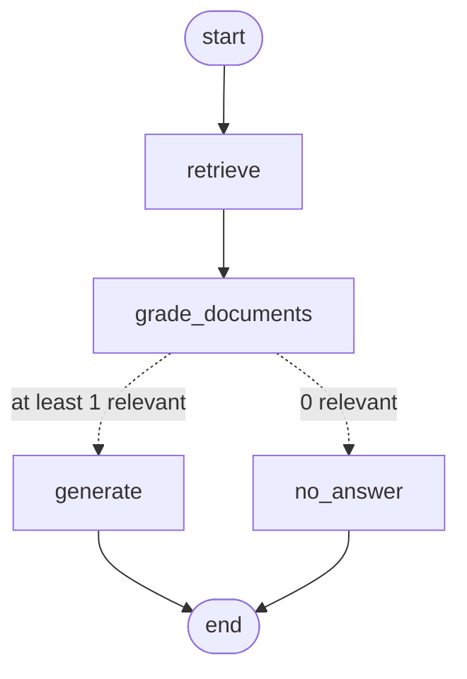

# Milestone 3 — LangGraph with Relevance Grading

**Status:** Built and tested. `ask.py` hasn't been run yet.
**Goal:** Rebuild the RAG flow as a LangGraph and add a step that checks whether each retrieved chunk is relevant. The model now only writes an answer when at least one chunk is relevant; otherwise the assistant says "I don't have a runbook for this" without calling the model. The query-rewrite loop and topic router are Milestone 4.

---

## What changed

| File | Purpose |
|---|---|
| `src/runbook_assistant/config.py` | New settings: `grader_model`, `graph_run_name`, `graph_tags`, `graph_diagram_path` |
| `src/runbook_assistant/graph/state.py` | `GraphState`: the data passed between the nodes |
| `src/runbook_assistant/graph/nodes.py` | The 4 nodes: `retrieve`, `grade_documents`, `generate`, `no_answer` |
| `src/runbook_assistant/graph/build.py` | `decide_next_step`, `build_graph`, `ask_graph` |
| `scripts/ask.py` | `--mode chain\|graph` (graph is the default). Graph mode shows which chunks were kept and which were filtered out |
| `scripts/draw_graph.py` | Writes the graph as a Mermaid diagram to `docs/graph.md` |
| `docs/graph.md` | The generated diagram |
| `tests/test_graph.py` | 5 tests for routing, wiring and grading, with no OpenAI calls |
| `src/runbook_assistant/rag.py` | **Not changed.** It's kept as the Milestone 2 baseline for evaluations |

---

## How it works



(`docs/graph.md` has the version generated from the code.)

| Node | Reads | Writes | LLM call? |
|---|---|---|---|
| `retrieve` | `question` | `documents` (top 4 chunks) | No (one embedding call) |
| `grade_documents` | `question`, `documents` | `relevant_documents` | Yes, one call per chunk, all at once with `.batch()` |
| `generate` | `question`, `relevant_documents` | `answer` | Yes |
| `no_answer` | — | `answer` = "I don't have a runbook for this" | **No** |

- **The grader** is `GRADER_PROMPT | ChatOpenAI(grader_model).with_structured_output(GradeDocument)`, where `GradeDocument` has a single field, `binary_score: "yes" | "no"`. The prompt is lenient: a chunk that is partly relevant counts as "yes".
- **`generate`** imports `PROMPT`, `format_docs` and `NO_ANSWER` from `rag.py`. The chain and the graph therefore answer by exactly the same rules, and the only difference between them is the grading step.
- **`ask_graph(question)`** returns `{answer, kept, filtered_out}`. Each run is sent to LangSmith with the run name `runbook-graph` and the tags `milestone-3` and `graph`.

---

## New concepts

- **StateGraph.** LangGraph's main building block: a graph of steps that all read and update one shared **state**. Unlike an LCEL chain, which always runs in a straight line, a graph can branch and, from Milestone 4, loop.
- **State.** A `TypedDict` (here `GraphState`) that describes the data moving through the graph. Every node receives the whole state and returns **only the keys it changed**, for example `{"answer": "..."}`. LangGraph merges that update into the state. `total=False` means a key doesn't have to exist until some node sets it.
- **Node.** A plain Python function, `state → dict of changes`, registered with `graph.add_node("name", fn)`. Because nodes are ordinary functions, you can test them on their own.
- **Edge.** `graph.add_edge("a", "b")` means "after `a`, always run `b`". `START` and `END` are special nodes for where the graph begins and ends.
- **Conditional edge.** `graph.add_conditional_edges("grade_documents", decide_next_step, {...})`. After `grade_documents` runs, LangGraph calls `decide_next_step(state)` and goes to whichever node name it returns. The routing logic is a pure function that makes no API calls, so it's easy to test.
- **Compile.** `graph.compile()` checks the wiring (for example, that there are no unreachable nodes or unknown targets) and returns a **Runnable**. You use it exactly like an LCEL chain: `.invoke({"question": ...})`, `.stream()` and `.batch()`, and it's traced in LangSmith automatically.
- **Structured output.** `llm.with_structured_output(PydanticModel)` makes the model reply with data that fits the schema, using OpenAI's structured outputs feature, and you get back a typed Python object. The grader therefore returns `GradeDocument(binary_score="yes")` rather than text like "Yes, this seems relevant…" that you would have to parse.
- **`.batch()`.** Runs the same Runnable on a list of inputs in parallel. Grading 4 chunks takes about as long as grading one.
- **`run_name` and `tags`.** You pass these in `config={...}` when calling `invoke`. They label the run in LangSmith, so you can filter by `milestone-3` or tell graph runs apart from chain runs.

---

## How to run / verify

```powershell
uv run ruff check . --fix; uv run ruff format .
uv run pytest                          # 15 passed (1 config + 9 ingest + 5 graph)
uv run python scripts/draw_graph.py    # regenerates docs/graph.md (no API calls)

uv run python scripts/ask.py "IIS app pool keeps stopping with event 5002"
uv run python scripts/ask.py --mode chain "IIS app pool keeps stopping with event 5002"
uv run python scripts/ask.py "How do I reset a Kubernetes pod?"
```

What to expect:
- **IIS question:** an answer that cites `iis-app-pool-crashes.md`. The IIS chunks should be **KEPT**, and any chunks from other runbooks should be **FILTERED OUT**.
- **Kubernetes question:** `I don't have a runbook for this`, with `KEPT (0)` and all 4 chunks filtered out. The generate step is never called, so the model has no chance to make up an answer.
- **LangSmith:** filter for the tag `milestone-3`. The trace shows each node as a separate step, including the 4 grader calls.

---

## Notes and decisions

- **Numbering.** Milestone 3 in these docs. The query rewrite and topic router are Milestone 4.
- **Models are created on first use.** `get_grader()` and `get_generator()` are cached and only create the models the first time they're needed. Importing the modules, compiling the graph and running `draw_graph.py` therefore never need an API key, and neither does CI.
- **Testing the grader without OpenAI.** The test replaces `get_grader` with a `RunnableLambda`, a small function wrapped as a Runnable that answers "yes" or "no" based on keywords. That tests the filtering logic without any API calls.
- **Trade-off: cost per question.** The graph makes 1 embedding call, 4 grader calls and 1 answer call per question, compared with 1 embedding call and 1 answer call for the chain. In exchange it filters out chunks that don't help and refuses questions with no matching runbook. Comparing the two properly is what LangSmith evaluations are for.

## Next milestone

**[Milestone 4 — Topic router and query-rewrite loop](04-router-rewrite.md):** send each question to a topic, filter retrieval by it, and rewrite the question and retry (searching every topic) when nothing relevant is found.
