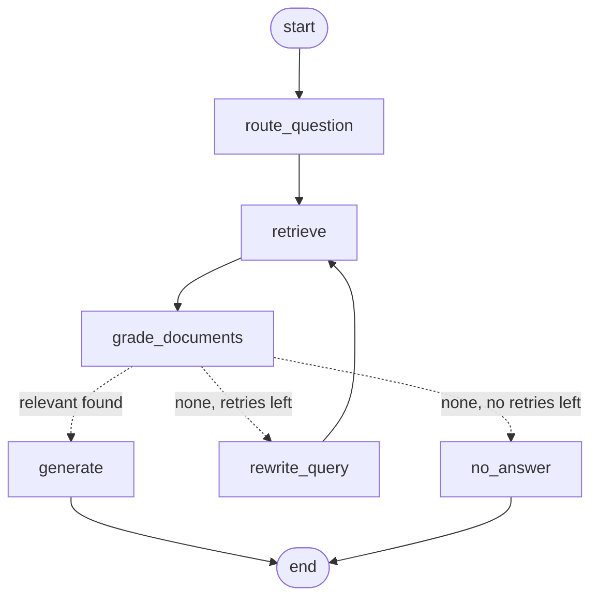

# Milestone 4 — Topic Router and Query-Rewrite Loop

**Status:** Built and tested. You need to re-run ingest, and `ask.py` hasn't been run yet.
**Goal:**
- Send each question to a topic, and search only that topic's runbooks first.
- If nothing relevant is found, rewrite the question into a better search query and search again across **all** topics.
- Give up after `max_retries` attempts.

---

## What changed

| File | Purpose |
|---|---|
| `data/runbooks/` | 3 new runbooks (security, networking, cicd), and a **Prevention** section added to the existing 3. There are now 6 runbooks and 76 chunks |
| `src/runbook_assistant/config.py` | `runbook_topics` is now a dict of topic → description, the single place topics are defined. New: `general_topic`, `rewrite_model`, `max_retries`, `router_topics`. The tags are now `milestone-4` |
| `src/runbook_assistant/graph/state.py` | New fields: `topic`, `search_query`, `search_queries` (history), `retry_count`, `filtered_documents` (history) |
| `src/runbook_assistant/graph/nodes.py` | New `route_question` and `rewrite_query` nodes. `retrieve` now uses `search_query` and a topic filter |
| `src/runbook_assistant/graph/build.py` | A 3-way `decide_next_step`, the loop edge, and `recursion_limit` |
| `src/runbook_assistant/retriever.py` | `get_retriever(k, metadata_filter)`. `rag.py` still calls it with no arguments, so its behaviour hasn't changed |
| `src/runbook_assistant/ingest.py` | Accepts the topic dict. Validation uses its keys |
| `scripts/ask.py` | Graph mode prints the topic, every search query, the retry count, chunks with their topic, and the answer |
| `docs/graph.md` | The regenerated diagram, which now shows the loop |
| `tests/test_graph.py` | 13 tests (up from 5) for decisions, the retry limit, filtering and the router schema |

### Runbooks per topic

| Topic | Runbooks |
|---|---|
| deployment | `iis-app-pool-crashes.md` |
| networking | `aws-ec2-unreachable.md`, `windows-dns-resolution-failures.md` |
| security | `iis-ssl-certificate-expired.md` |
| cicd | `azure-devops-pipeline-failures.md`, `github-actions-deploy-failures.md` |

---

## How it works



### Example run (`max_retries = 1`, nothing relevant on the first try)

| Step | Node | What happens |
|---|---|---|
| 1 | `route_question` | topic = `deployment`, search_query = the question, retry_count = 0 |
| 2 | `retrieve` | Searches with Chroma filter `{"topic": "deployment"}` |
| 3 | `grade_documents` | Every chunk is graded "no" against the **original question** |
| 4 | decision | Nothing relevant, `0 < 1` → `rewrite_query` |
| 5 | `rewrite_query` | search_query = "IIS application pool stopped 503 after deployment", retry_count = 1 |
| 6 | `retrieve` | Searches with **no filter** (all topics) |
| 7 | `grade_documents` | Some chunks are "yes" |
| 8 | decision | Relevant chunks found → `generate`, which answers the **original question** |

If step 7 also finds nothing, the decision becomes `1 < 1` → false → `no_answer`.

### Router
- Schema: `RouteQuestion(topic: Literal["deployment", "networking", "security", "cicd", "general"])`. It's built at runtime from `config.router_topics`, so the topics are defined in one place.
- The prompt lists each topic with its description from config. `general` means "doesn't clearly fit one topic, spans several, or isn't DevOps".

### Cost per question

| Path | Calls |
|---|---|
| Found on first try | 1 router + 1 embedding + 4 grader + 1 answer |
| Found after a rewrite | the above + 1 rewrite + 1 embedding + 4 grader |
| Gives up | 1 router + 2 embedding + 8 grader + 1 rewrite, and **no** answer call |

---

## New concepts

- **Loops (cycles) in LangGraph.** A plain LCEL chain can only run in one direction. In a StateGraph, an edge can point **back** to an earlier node: `graph.add_edge("rewrite_query", "retrieve")`. Together with a conditional edge, this lets the graph go "try → check → try again". Each time it goes round, the state carries what changed (`search_query`, `retry_count`), so the next attempt behaves differently.
- **Reducers.** By default, a node's update **replaces** a state key. `Annotated[list[str], operator.add]` tells LangGraph to **combine** the update with the existing value instead, here by joining the lists. `rewrite_query` returns `{"search_queries": [new_query]}`, and the state ends up with every query in order. `filtered_documents` works the same way, so chunks rejected on the first attempt aren't lost.
- **Metadata filtering in Chroma.** Each chunk was stored with metadata (`topic`, `source`, …) at ingest. Passing `search_kwargs={"filter": {"topic": "security"}}` makes Chroma search **only** the chunks whose metadata matches, and then rank them by similarity. This cuts out unrelated topics before ranking, so a "certificate" question can't pull in a pipeline runbook just because the wording is similar. Because the filter is exact, a wrong route means the right chunks are never searched, which is why retries search without the filter.
- **Why retries are capped.** Each loop costs a rewrite call, an embedding and 4 grader calls, and adds latency. If there's no runbook for the question (Kubernetes, say), rewriting won't make one appear. Without a cap, the graph could loop until it hits LangGraph's step limit and crashes. `decide_next_step` stops at `max_retries` because `retry_count` only ever goes up. `recursion_limit` is a second safeguard: LangGraph stops the run if the step count ever goes beyond the worst case we calculated.
- **Why we keep the original question.** The rewritten query is written for **search**: keywords like "IIS application pool stopped 503". It isn't what the user asked. If the grader judged chunks against the rewrite, or `generate` answered the rewrite, then a bad rewrite would quietly change the question. So the graph keeps:
  - `question`, which is never modified and is used for grading and answering
  - `search_query`, which is used only for retrieval
- **Building a Pydantic model at runtime.** `create_model("RouteQuestion", topic=(Literal[...], Field(...)))` builds the schema from config. Structured output then sends OpenAI a JSON schema with `enum: [deployment, …, general]`, so the model can't return anything else, and Pydantic rejects any other value.

---

## How to run / verify

```powershell
uv run ruff check . --fix; uv run ruff format .
uv run pytest                          # 23 passed (1 config + 9 ingest + 13 graph)
uv run python scripts/draw_graph.py    # regenerates docs/graph.md

uv run python -m runbook_assistant.ingest   # re-ingest. Expect: 6 files, 76 chunks
uv run python scripts/ask.py "SSL cert expired on our IIS site"
uv run python scripts/ask.py "website dead after new build"
uv run python scripts/ask.py "DNS not resolving internal names on Windows server"
uv run python scripts/ask.py "How do I reset a Kubernetes pod?"
```

What to expect:
- **SSL question:** topic `security`, 1 search query, 0 retries, and the kept chunks come from `iis-ssl-certificate-expired.md`.
- **"website dead after new build":** vague. The router may choose `deployment` or `general`. If the first search finds nothing relevant, you'll see a second, rewritten query and `Retries: 1`.
- **Kubernetes question:** 2 search queries (the original and a rewrite), `Retries: 1`, `KEPT (0)`, and `I don't have a runbook for this`.
- **LangSmith:** filter for the tag `milestone-4`. A retry run shows `retrieve` and `grade_documents` twice.

---

## Notes and decisions

- **Runbook structure.** All 6 runbooks now have the sections Symptoms → Likely Causes → Diagnosis Steps → Resolution → **Prevention** → Escalation.
- **`general` isn't a valid runbook topic.** The router can choose it, but ingest rejects it in frontmatter. A `general` route searches every topic straight away.
- **The grader is unchanged.** It still grades against the original question.
- **`filtered_out` in `ask.py`** lists rejected chunks from **all** attempts. `kept` comes from the final attempt.
- **Testing without OpenAI.** The tests replace the router, retriever, grader, rewriter and generator with `RunnableLambda` fakes and run the **real** compiled graph. They show that:
  - the loop ends at exactly `max_retries` for 0, 1 and 3
  - the first search is filtered by topic and retries aren't
  - `generate` receives the original question
- **The `recursion_limit` fix.** LangGraph stops a run when the number of steps reaches the limit. So the limit is set to the worst-case step count **+ 1**; the tests caught the off-by-one.
- **The `rag.py` baseline** is unchanged.

## Next milestone

Options to choose from:
- **LangSmith evaluations:** a dataset of in-scope and out-of-scope questions, scoring chain vs graph on correct refusals, grounding and cost.
- **Streamlit UI** (`app.py`).
- **Hybrid search:** BM25 keyword search plus vector search, for exact error codes like `5002` or `AADSTS70021`.
