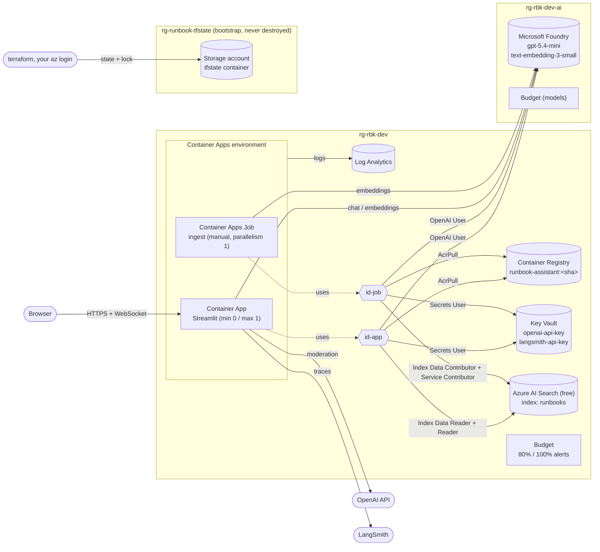

# Azure infrastructure (Terraform)

This folder creates everything the Runbook Assistant needs in Azure: the Streamlit app, the ingest job, the registry for the image, Azure AI Search, Key Vault, logs and a budget. It uses **Terraform** with the **azurerm v5** provider, and PowerShell scripts in `scripts/` run each step.

Every command that creates or changes Azure resources is run by you. The only local checks are `terraform fmt`, `terraform init -backend=false`, `terraform validate`, `tflint` and `trivy`.

## Architecture



## Resources and why they exist

| Resource | Module | Why |
|---|---|---|
| Resource group `rg-rbk-dev` | root | One container per environment: easy to see, cost and delete together |
| Log Analytics workspace | `logs` | Container stdout/stderr (app logs, guardrail events, ingest reports) and system events, queryable with KQL. 1 GB/day cap as a cost guard |
| Container Registry (Basic, admin user off) | `acr` | Stores the image. Pulled with managed identities, so no registry password exists |
| Key Vault (RBAC, soft delete) | `keyvault` | Holds the API keys. Terraform creates the vault only; values are set by `set-secrets.ps1` |
| Azure AI Search (free) | `search` | The vector + keyword index. Entra ID only (API keys disabled). The **index** is created by the ingest job, not Terraform |
| Managed identities `id-app`, `id-job` | `identity` | Identities without passwords for the app and the job, each with only the roles it needs |
| Container Apps environment | `environment` | The serverless runtime the app and job share; sends logs to Log Analytics |
| Container App `ca-rbk-dev-app` | `containerapp` | The Streamlit UI, public HTTPS, scales to zero |
| Container Apps Job `caj-rbk-dev-ingest` | `job` | Runs `python -m runbook_assistant.ingest` on demand from the same image |
| Budget | `budget` | Emails at 80% and 100% of the monthly amount (alerts only; it never stops anything) |
| Resource group `rg-rbk-dev-ai` | root | The model layer, separate so it can be costed and deleted on its own |
| Microsoft Foundry resource + project + model deployments | `foundry` | Chat and embedding models in our subscription. Entra ID only (keys disabled). Deployments are named after their models, so the app's model names are the deployment names |
| Budget (models) | `budget` | Same alerts for `rg-rbk-dev-ai` (`ai_budget_amount`) |
| Role assignments + `time_sleep` | root | Connect identities to resources; wait for propagation before the app is created |

Names follow `{type}-{prefix}-{env}[-{suffix}]`. The 4-character random suffix makes the globally unique names (Key Vault, ACR, Search) unique; ACR allows only letters and digits, so it becomes `acrrbkdev<suffix>`. Every resource is tagged `app`, `environment`, `owner`, `managedBy=terraform`.

## Identities and roles (least privilege)

Every role is scoped to the single resource, not the resource group.

| Who | Role | On | Why |
|---|---|---|---|
| id-app | AcrPull | ACR | Pull the image |
| id-app | Key Vault Secrets User | Key Vault | Read the secret values (Key Vault references) |
| id-app | Search Index Data Reader | Search | Run queries |
| id-app | Reader | Search | LangChain's `AzureSearch` reads the **index definition** on start-up (`GET /indexes/<name>`), which the data reader role doesn't allow. Reader can view definitions but not keys, documents or settings changes |
| id-job | AcrPull, Key Vault Secrets User | ACR, Key Vault | As above |
| id-job | Search Index Data Contributor | Search | Upload and delete documents |
| id-job | Search Service Contributor | Search | Create, delete and reset the index (object definitions). It could also read admin keys, but keys are disabled on the service |
| id-app, id-job | Cognitive Services OpenAI User | Foundry | Call the model deployments (no keys, no management rights) |
| you | Key Vault Secrets Officer | Key Vault | Set the secrets |
| you | Cognitive Services OpenAI User | Foundry | Call the models locally with `az login` (`LLM_PROVIDER=foundry`) |
| you | Search Index Data Contributor + Search Service Contributor | Search | Inspect the index in the portal; run ingest or the app locally with `az login` |

"You" means `owner_object_id`, or whoever runs Terraform if it's unset.

**Search authentication choice.** Microsoft's docs say RBAC for the data plane works on *any tier, including free*. The free tier's "no managed identities" note is about the Search service's *own* identity, used for outbound calls such as indexers, which we don't use. So the service runs with `local_authentication_enabled = false` (keys refused). If RBAC ever has to be bypassed, set `search_local_auth_enabled = true`, run `set-secrets.ps1 -IncludeSearchAdminKey`, and the containers get `AZURE_SEARCH_API_KEY` from Key Vault.

**Propagation delay.** A new role assignment can take minutes to apply, and Microsoft notes that Search roles for managed identities can take longer. `time_sleep` waits 120 s before the app and job are created, so the first image pull and Key Vault read succeed. If the first ingest or query returns 403, wait a few minutes and retry (`run-ingest.ps1`, or restart the app revision).

## State: what it is and how it's protected

- **State** is Terraform's record of what it created: resource IDs and every attribute it read back. On each plan Terraform compares your code with the state and with Azure, and the differences become the plan.
- **Backend** = where the state lives. It's in a blob (`dev.tfstate`) in a storage account that `bootstrap-state.ps1` creates in its own resource group. Destroying the app environment can never delete its own state.
- **Locking.** While a plan or apply runs, Terraform holds a lease on the blob, so two runs can't change the same state at once. If a crash leaves a lock behind, run `terraform force-unlock <id>`.
- **Access.** `use_azuread_auth = true`: Terraform uses your Entra ID login (Storage Blob Data Contributor). Shared key access is disabled, so a leaked account key couldn't be used. TLS 1.2+, no public blob access, versioning (every state write keeps the previous version, which lets you recover from a bad write) and 14-day soft delete.

**What can end up in state.** Terraform stores provider attributes in plain text, even ones it never outputs. Here that means the Search admin and query keys (exported by the provider even though keys are disabled), the Log Analytics shared keys, and identity IDs. The OpenAI and LangSmith keys are **not** in state: Terraform only knows their Key Vault *URLs*. That's why the state account is locked down like a secret store, and why secret values go to Key Vault directly instead of through `azurerm_key_vault_secret`, which would put them in state.

## Secrets: Key Vault references

The app's `secret` blocks hold a version-less Key Vault secret ID (`https://kv-…vault.azure.net/secrets/openai-api-key`) and the identity to read it with. When a revision starts, Container Apps fetches the current value with `id-app` and injects it as `OPENAI_API_KEY`. The value never appears in Terraform, the plan, state or the image. After changing a secret, restart the revision so running replicas pick it up.

| Key Vault secret | Env var in the containers |
|---|---|
| `openai-api-key` | `OPENAI_API_KEY` |
| `langsmith-api-key` | `LANGSMITH_API_KEY` |
| `search-admin-key` (fallback only) | `AZURE_SEARCH_API_KEY` |

Plain settings (in `locals.tf`): `VECTOR_STORE=azure_search`, `RETRIEVAL_MODE=hybrid`, `AZURE_SEARCH_ENDPOINT`, `AZURE_SEARCH_INDEX_NAME=runbooks`, `LANGSMITH_TRACING=true`, `LANGSMITH_PROJECT=runbook-assistant-prod`, `LLM_PROVIDER=foundry`, `FOUNDRY_ENDPOINT`, `AZURE_CLIENT_ID` (each container's own identity), and for the app `RATE_LIMIT_TRUST_FORWARDED_FOR=true`. Container Apps ingress is a trusted proxy that sets `X-Forwarded-For`; without this setting every user would share the proxy's IP in the per-IP rate limit.

## Deploying step by step

**Prerequisites:**
- Terraform 1.16, Azure CLI, and git
- `az login`, then `az account set --subscription <id>`
- Owner (or Contributor + User Access Administrator) on the subscription, since Terraform creates role assignments
- Free search tier: one per subscription

**Edit first:**
- `environments/dev/dev.tfvars`: `subscription_id`, `location`, `owner`, `budget_alert_emails`
- `environments/dev/backend.hcl`: a globally unique `storage_account_name`

Run everything from `infra/`:

```powershell
# 0. Once: state backend, then connect Terraform to it
./scripts/bootstrap-state.ps1 -Location westeurope
./scripts/init.ps1

# 1. Base infrastructure (no app yet)
./scripts/plan.ps1                 # deploy_apps = false
./scripts/apply.ps1                # shows the summary, type 'apply'

# 2. Secrets and image (the app needs both before it can start)
./scripts/set-secrets.ps1          # prompts, input hidden
git commit ...                     # the image tag is the commit SHA
./scripts/build-image.ps1          # az acr build -> runbook-assistant:<sha>

# 3. App + ingest job
./scripts/plan.ps1 -DeployApps     # image_tag = current git SHA
./scripts/apply.ps1

# 4. Load the runbooks into Azure AI Search, then open the app
./scripts/run-ingest.ps1
terraform output app_url
```

**Later changes:**
- **New code:** commit, run `build-image.ps1`, then `plan.ps1 -DeployApps` and `apply.ps1`. The new tag creates a new revision.
- **Changed runbooks:** they're in the image, so build and deploy, then run `run-ingest.ps1`. Only changed files are re-embedded.
- **Roll back:** `plan.ps1 -DeployApps -ImageTag <older sha>`, then `apply.ps1`.
- **Rotate a key:** run `set-secrets.ps1`. It refreshes the app and job and restarts the app.

## Concepts

- **Provider.** A plugin that turns Terraform resources into API calls. `azurerm` calls Azure Resource Manager; `random` makes the name suffix; `time` provides `time_sleep` and `time_static`. Versions are pinned in `versions.tf`. `.terraform.lock.hcl` (committed) records the exact build and checksums, so everyone runs identical provider code. Run `./scripts/init.ps1 -Upgrade` to move within the pins.
- **Modules.** A folder of `.tf` files with inputs (variables) and outputs, called from the root with `module "x" { source = "./modules/x" }`. Each module here is one building block. The root module wires them together and owns the cross-cutting parts: role assignments, naming and tags.
- **Variables, locals, outputs.**
  - Variables are inputs set from outside (`dev.tfvars`, `-var`).
  - Locals are values computed inside and reused (names, tags, env vars); they can't be set from outside.
  - Outputs are values exposed after apply (`terraform output app_url`), which the scripts read. `sensitive = true` on a variable or output hides it from CLI output, but it's still in state.
- **Plan vs apply.**
  - `plan` compares code, state and Azure, and shows what would be created, changed or destroyed, without touching anything.
  - `apply` makes the changes.
  - **Why apply a saved plan:** `plan -out=tfplan`, then `apply tfplan` applies exactly what you reviewed. If Azure or the state changed in between, Terraform rejects the stale plan instead of quietly doing something else. `apply.ps1` adds a summary and a typed confirmation.
- **`count` for `deploy_apps`.** `count = var.deploy_apps ? 1 : 0` on the app and job modules makes them exist or not; `one(module.app[*].url)` gives `null` when they don't. Planning with `deploy_apps = false` after they exist **removes** them, which is what `destroy.ps1 -AppsOnly` uses.
- **Managed identities.** Entra ID identities managed by Azure, with no secret to store or rotate. Inside the container, `DefaultAzureCredential` asks the platform for a token for the identity named by `AZURE_CLIENT_ID`. They're user-assigned, not system-assigned, so they exist (with roles propagated) *before* the app does.
- **RBAC role assignments.** A role assignment is principal + role + scope. Built-in roles are used throughout, each scoped to one resource. Data-plane roles (Key Vault Secrets User, Search Index Data Reader) control access to *contents*; control-plane roles (Reader, Contributor) control the *resource*.
- **Key Vault references.** See "Secrets" above. The container gets the value as an env var; only the reference is in config.
- **Scale to zero and cold starts.**
  - With `min_replicas = 0`, the app has no replica when idle and costs nothing for compute. The next request waits while a replica starts and Streamlit loads: a **cold start** of roughly 10–30 s.
  - The startup probe allows up to about 2 minutes. Liveness then restarts a stuck container; readiness only sends traffic to a replica that answers `/_stcore/health`.
  - Set `app_min_replicas = 1` to avoid cold starts. It then costs more, because one replica is always billed.
- **Revisions.** Every change to the app's `template` (image tag, env, CPU) creates a new immutable revision. In `Single` mode, the new revision gets all traffic once healthy and the old one is deactivated (the last 3 are kept for reference). A failed new revision leaves the old one serving.
- **Why max 1 replica, and session affinity.**
  - Streamlit keeps each user's chat in the memory of the replica holding that browser's WebSocket, and so do our rate limiters. With two replicas, a reconnect could land on the other replica and lose the chat, and each replica would have its own rate limits.
  - **Sticky sessions** (session affinity, single-revision mode only; not exposed by azurerm, so it would need `azapi`) keep a browser on one replica. That fixes the reconnect case, but chats still vanish when a replica scales in or restarts, and the limits stay per-replica.
  - So: keep `max_replicas = 1` until chat history and limits move to a shared store such as Redis.
- **One ingest writer.** Azure AI Search has no lock file, so the job uses `parallelism = 1` and `replica_completion_count = 1`. `run-ingest.ps1` refuses to start while an execution is running.

## Quality and security checks

```powershell
terraform fmt -recursive -check
terraform init -backend=false; terraform validate
tflint --init; tflint --recursive
trivy config --ignorefile .trivyignore.yaml --tf-vars environments/dev/dev.tfvars .
```

`.trivyignore.yaml` lists only justified exceptions: the Key Vault has no network ACL, because Consumption Container Apps have no fixed outbound IPs; and purge protection is off in dev. Each entry explains why and when to remove it.

For a CI runner on Linux, add its checksums to the lock file once: `terraform providers lock -platform=windows_amd64 -platform=linux_amd64`.

## Cost notes (approximate; check the Azure pricing pages for your region)

| Resource | Cost |
|---|---|
| Container Registry Basic | ~$5/month, the only fixed cost |
| Container Apps (Consumption) | Monthly free grant (vCPU-seconds, GiB-seconds, requests). Scaled to zero plus occasional short ingests usually stays inside it |
| Azure AI Search free | $0 (50 MB, 3 indexes, one per subscription; may be removed if inactive for a long time during capacity shortages) |
| Log Analytics | Pay per GB ingested (some free monthly allowance per billing account); capped at 1 GB/day here |
| Key Vault | Fractions of a cent per 10,000 operations |
| State storage account | Cents |
| OpenAI / LangSmith | Billed by those services, not Azure. The budget doesn't include them |

## Tear down

```powershell
./scripts/destroy.ps1 -AppsOnly   # remove just the app and job (stops all compute)
./scripts/destroy.ps1             # everything in rg-rbk-dev; type the RG name to confirm
```

- Key Vault is purged on destroy while purge protection is off, so the name is free again. Log Analytics is deleted permanently.
- The state backend (`rg-runbook-tfstate`) is never touched. Delete it by hand (`az group delete -n rg-runbook-tfstate`) only when you're finished with the project.

## Troubleshooting

- **`ACR Tasks requests are not permitted`** (some free or trial subscriptions): build locally and push instead:
  ```powershell
  az acr login -n <acr_name>
  docker build -t <acr_login_server>/runbook-assistant:<sha> ..
  docker push <acr_login_server>/runbook-assistant:<sha>
  ```
  You need push rights on the registry: Owner, Contributor or AcrPush.
- **New revision stuck / "unable to fetch secret".** The Key Vault secret doesn't exist yet (run `set-secrets.ps1`) or the role hasn't propagated (wait, then restart the revision).
- **Changed a secret but the app or job still uses the old value.** Container Apps caches Key Vault values and refreshes them about every 30 minutes. `set-secrets.ps1` forces a refresh: it re-applies the references and restarts the app. If you changed a secret another way, run `set-secrets.ps1` again with the same value, or wait 30 minutes.
- **`openai.BadRequestError: Error code: 400` with no message.** The OpenAI key is malformed (cut off, quoted, or with spaces). Check its length in Key Vault without printing it: `(az keyvault secret show --vault-name <kv> -n openai-api-key --query value -o tsv).Length`.
- **403 from Search on the first ingest or query.** Role propagation. Wait a few minutes and retry.
- **Key Vault name conflict on re-create.** A soft-deleted vault with that name still exists. With purge protection off it's purged on destroy; otherwise wait out the retention period or change the prefix.
- **Plan always shows a change to a container's `secret` block.** The provider recommends ignoring `value` when using `key_vault_secret_id`. If you see a persistent diff here, add `lifecycle { ignore_changes = [secret] }` to the module (secrets then change only by recreating the app).
